# OpFan — One Piece Fan App

> Set sail with the Straw Hats — a One Piece fan catalog and a crew of AI-powered life assistants in one Flutter app.


OpFan has two halves:

- **A fan catalog** — canon characters, Devil Fruits, a character of the day with AMVs,
  and your own pirates, crews and duels.
- **A crew of persona assistants** — Nami runs your finances, Zoro your workouts,
  Sanji your nutrition, Robin your goals, and Dr. Vegapunk chats with you. Nami and
  Vegapunk run a **Gemma LLM fully on the device**, with tool calling and RAG, so your
  data and conversations never leave the phone.

<p align="center">
  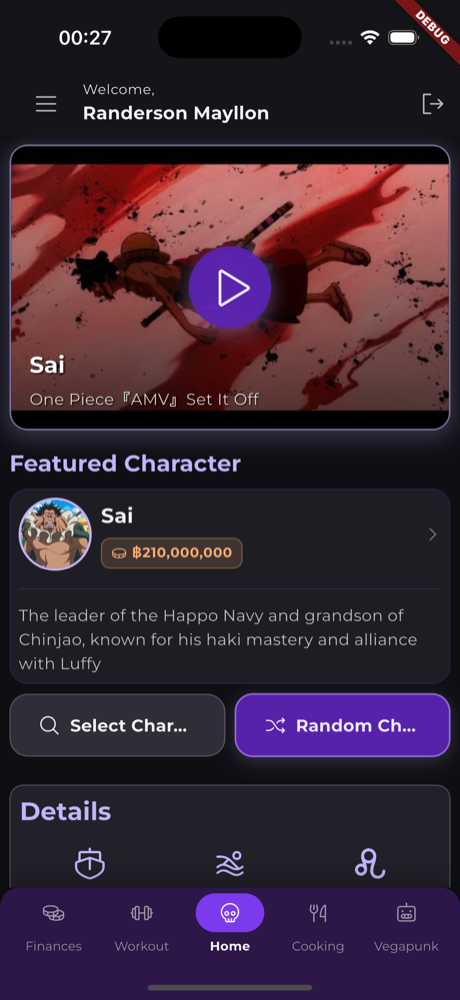
  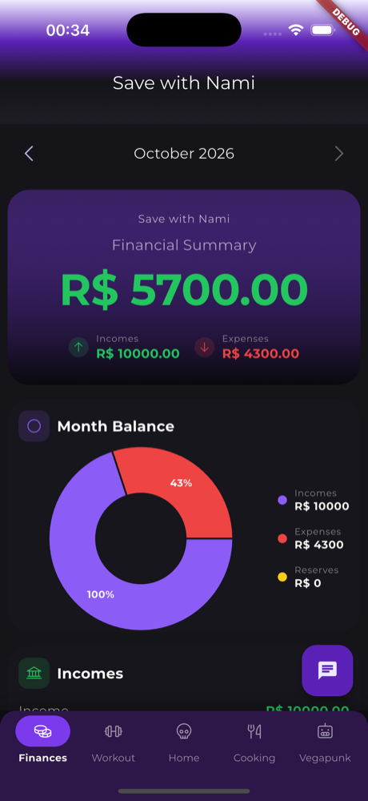
  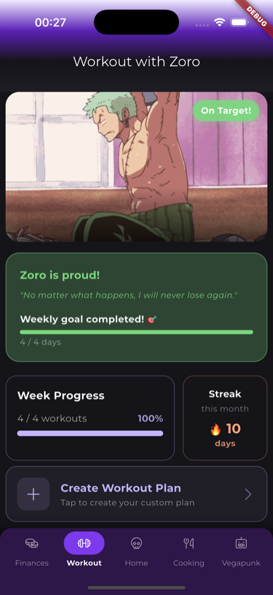
  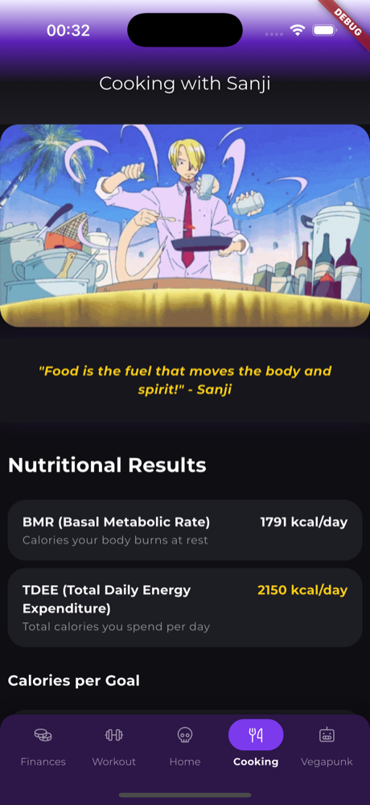
  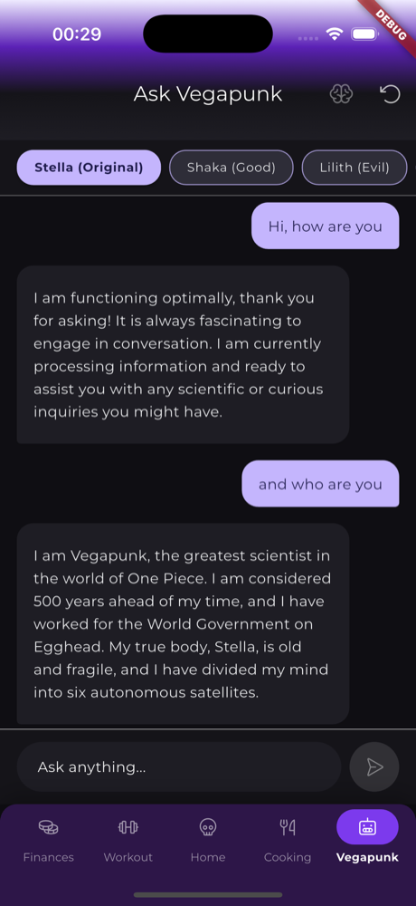
</p>

## Table of contents

- [Features](#-features)
  - [Home & catalog](#-home--fan-catalog)
  - [Nami — finances](#-nami--save-with-nami)
  - [Zoro — workout](#%EF%B8%8F-zoro--workout-with-zoro)
  - [Sanji — nutrition](#-sanji--cooking-with-sanji)
  - [Robin — goals](#-robin--goals-planner)
  - [Vegapunk — on-device chat](#-vegapunk--ask-vegapunk)
- [How the on-device AI works](#-how-the-on-device-ai-works)
- [Architecture](#%EF%B8%8F-architecture)
- [Tech stack](#-tech-stack)
- [Running locally](#-running-locally)
- [Environment variables](#-environment-variables)
- [Development](#-development)
- [Notes & known limits](#-notes--known-limits)
- [Documentation](#-documentation)
- [Contributing](#-contributing)

## ✨ Features

### 🌊 Home & fan catalog


- **Character of the day** — picked at random from the catalog and cached for the day.
  Choose one manually or shuffle again whenever you want.
- **AMV player** — a One Piece AMV of the featured character, searched on YouTube.
- **Character catalog** — browse and search canon characters by name, nickname,
  affiliation or crew.
- **Devil Fruit encyclopedia** — Paramecia, Zoan and Logia fruits from the One Piece API.
- **Custom characters** — create your own pirate: bounty, Devil Fruit, Haki, fighting
  style, up to three occupations; age and zodiac sign are derived from the birth date.
- **Crews** — assemble a crew across 11 roles (captain, navigator, cook, doctor, …).
  The Jolly Roger and the ship are generated by Gemini.
- **Duels** — put canon and custom characters face to face and see who wins on score.

<br clear="right"/>

### 💰 Nami — Save with Nami

<p>
  
  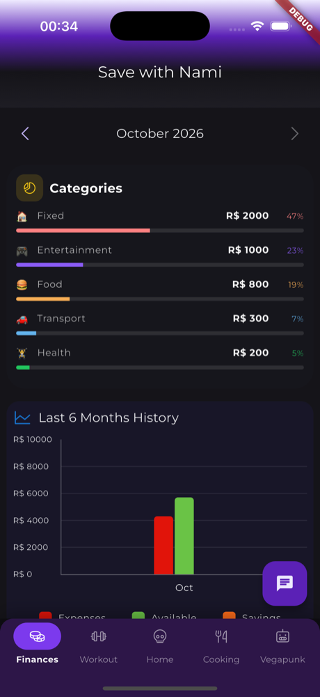
</p>

A monthly budget in BRL that lives **only on your device** (Hive, no cloud).

- Incomes, expenses by category (fixed, food, transport, entertainment, health, other)
  and reserves with a purpose (emergency, travel, goal, investment).
- Financial summary, month balance donut and a 6-month history chart.
- Navigate month by month; past months stay editable, future months are locked.
- **Chat with Nami** (the floating button): ask in plain language and an on-device
  assistant answers from your own numbers —
  *"how much did I spend on food?"*, *"can I afford a R$ 3,000 phone in 10 installments?"*,
  *"how long to save R$ 10,000?"*, *"split my budget 50/30/20"*,
  *"find my Uber expenses"*.

### ⚔️ Zoro — Workout with Zoro

<p>
  
  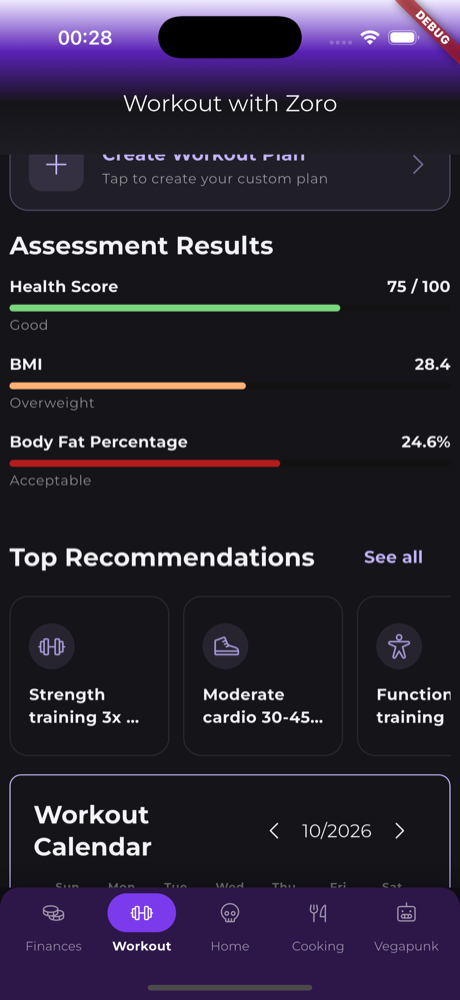
  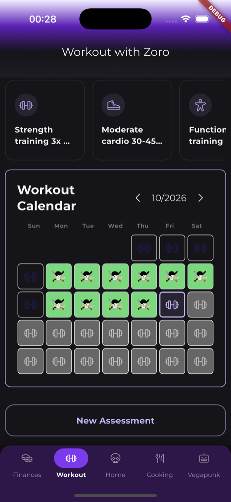
</p>

- **Monthly body assessment** — health score, BMI and body fat percentage, each with a
  classification.
- **Top recommendations** tailored to the assessment.
- **Custom workout plan** — define splits and exercises; today's split rotates
  automatically as you train.
- **Workout calendar** — every trained day gets Zoro's Jolly Roger.
- **Weekly goal and monthly streak**, with Zoro's mood reacting to your progress.
- Log a workout by just telling Vegapunk *"I trained today"*.

### 🍳 Sanji — Cooking with Sanji

<p>
  
  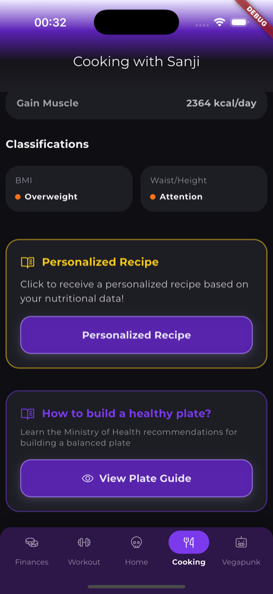
</p>

- **Nutrition calculator** from your body profile — BMR (Mifflin-St Jeor), TDEE by
  activity level, and daily calories per goal (lose weight, maintain, gain muscle).
- **Classifications** — BMI and waist-to-height ratio.
- **Personalized recipe** — Sanji (Gemini) cooks up a recipe that fits your numbers.
- **Healthy plate guide** — how to build a balanced plate, following the Brazilian
  Ministry of Health guidelines.
- Cooking tips in Sanji's voice.

### 📚 Robin — Goals planner

- Goals with category (study, work, personal, health, finance), deadline, tags and notes.
- Progress from 0 to 100 % drives the status automatically (not started → in progress →
  completed, or overdue).
- Timeline view with a timestamped note every time progress changes.

### 🤖 Vegapunk — Ask Vegapunk


A chat with Dr. Vegapunk that runs **entirely on the device** after a one-time model
download.

- **Seven satellites** — Stella, Shaka, Lilith, Edison, Pythagoras, Atlas and York —
  each answering in its own style in the same conversation.
- **Thinking mode** (🧠) for more careful, focused answers.
- **Tools** — Vegapunk can read your profile, check and log workouts, look up
  characters and, when online, search the web.
- **Memory** — One Piece lore and past conversations are retrieved with RAG; chat
  history is kept locally.
- Works **offline**; only the web search needs a connection.

<br clear="right"/>

### And also

Google Sign-In with **guest mode** · onboarding · profile · offline banner · push
notifications (scheduled reminders from Nami, Zoro and Sanji via Cloud Functions + FCM) ·
light and dark themes · English and Portuguese · a calculator.

## 🧠 How the on-device AI works

Nami and Vegapunk run **Gemma 4 E2B** locally through `flutter_gemma` (LiteRT-LM),
with a Gecko embedder and a sqlite vector store for RAG. A 2B model is great at
phrasing but weak at arithmetic and at deciding when to call a tool, so the app
follows one rule: **Dart does the routing and the math; the model only writes the
answer.**

**Nami** never lets the model pick a tool:

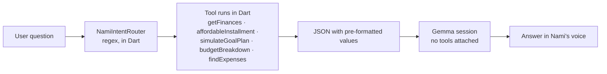

**Vegapunk** tries three paths, from most to least deterministic:

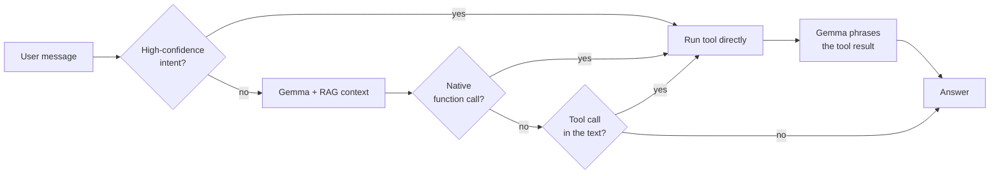

| | Nami | Vegapunk |
|---|---|---|
| Tools | `getFinances`, `affordableInstallment`, `simulateGoalPlan`, `budgetBreakdown`, `findExpenses` | `getUserProfile`, `getWorkoutHistory`, `saveWorkout`, `getCharacterInfo`, `searchInternet` |
| RAG store | One document per described expense | One Piece lore + past conversation turns |
| Network | Never | Only for `searchInternet` (Tavily) |

**Gemini** (cloud) is a separate stack, used only for Sanji's recipes and tips and for
character and crew images. It is rate-limited and falls back to built-in content when no
key is configured.

## 🏗️ Architecture

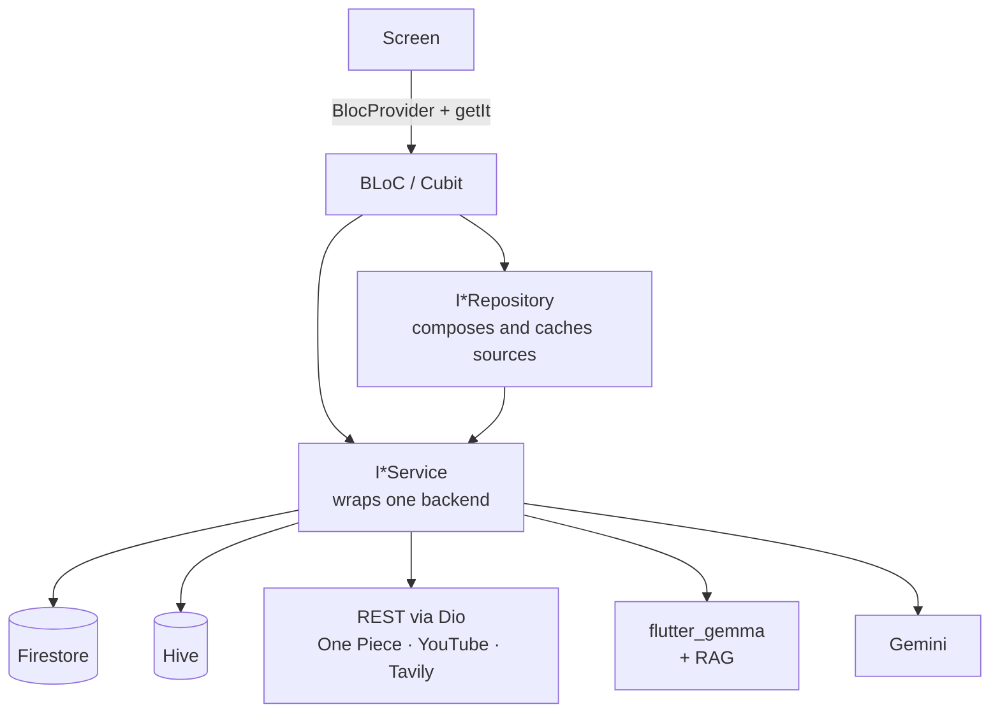

- BLoCs receive everything through the constructor, typed as abstract
  `I*Repository` / `I*Service`, wired with GetIt in `lib/app/di/`.
- No domain layer and no use cases: BLoC → repository/service → source.
- Every user-facing string lives in the ARB files; every colour comes from the theme.

```
lib/
├── app/di/        GetIt modules (core → theme → locale → features)
├── core/          auth, AI prompts, services (gemma, rag, gemini, finances, …), storage, theme, locale
├── features/<f>/  bloc/ · data/ · presentation/ · tools/ · <f>_routes.dart
├── shared/        atomic-design widgets (atoms / molecules / organisms) and utils
└── l10n/          intl_en.arb, intl_pt.arb + generated AppLocalizations
functions/         Cloud Functions (TypeScript) — scheduled push notifications
```

Full conventions: [`CLAUDE.md`](CLAUDE.md) and `.claude/rules/`.

## 🔧 Tech stack

| | |
|---|---|
| **Flutter / Dart** | Flutter 3.44.4 / Dart ≥ 3.12, pinned with [FVM](https://fvm.app/) in `.fvmrc` |
| **State & DI** | `flutter_bloc` (BLoC/Cubit) · `get_it` |
| **Backend** | Firebase Auth (Google), Firestore, Cloud Functions, FCM |
| **Local storage** | Hive |
| **Networking** | Dio (One Piece API, YouTube Data API, Tavily) |
| **AI on-device** | `flutter_gemma` + LiteRT-LM — Gemma 4 E2B, Gecko embeddings, sqlite vector store |
| **AI cloud** | `google_generative_ai` — Gemini 2.5 Flash Lite (text) and Flash Image |
| **UI** | Atomic design, `phosphoricons`, `fl_chart` |
| **i18n** | ARB files (en, pt) with generated `AppLocalizations` |
| **Tests** | `bloc_test`, `mocktail` |

## 🚀 Running locally

### 1. Prerequisites

- [FVM](https://fvm.app/) — `dart pub global activate fvm`
- Xcode (iOS 16+) and/or Android Studio (Android `minSdk` 28)
- A Firebase project with Google Sign-In enabled
- For the AI chats: a device or simulator with enough memory for a ~2B model

> Always use `fvm flutter` / `fvm dart`. The global `flutter` may be older than the
> project's SDK constraint.

### 2. Install the SDK and dependencies

```bash
git clone <repo-url> && cd flutter_app
fvm install
fvm flutter pub get
```

### 3. Configure Firebase

These files are git-ignored and must be generated for your own Firebase project:

| File | How to get it |
|---|---|
| `lib/firebase_options.dart` | `flutterfire configure` ([FlutterFire CLI](https://firebase.google.com/docs/flutter/setup)) |
| `android/app/google-services.json` | Firebase console → Android app, or `flutterfire configure` |
| `ios/Runner/GoogleService-Info.plist` | Firebase console → iOS app, or `flutterfire configure` |

Step-by-step guides: [`firebase-setup.md`](docs/firebase-setup.md) (Auth / Google Sign-In)
and [`firestore-setup.md`](docs/firestore-setup.md) (database and rules).

### 4. Create the `.env` file

```bash
cp .env.example .env
```

Then fill in the keys you need — see [Environment variables](#-environment-variables).
The file is passed at build time (`--dart-define-from-file=.env`); it is never bundled
into the app.

### 5. Generate code and run

```bash
fvm flutter gen-l10n                    # localization classes
fvm dart run build_runner build -d      # @JsonSerializable models
fvm flutter devices
fvm flutter run -d <device-id> --dart-define-from-file=.env
```

The first time you open **Vegapunk**, the app downloads the Gemma model to the device
(a few GB, once). Nami's chat reuses that same model, so open Vegapunk once before
chatting with Nami. After that both run offline.

## 🔑 Environment variables

`.env` holds build-time values passed with `--dart-define-from-file=.env`. Every key
is optional: a missing key falls back to its default, and a missing API key turns
that one feature off gracefully. Everything here is compiled into the binary, so it
only holds free-plan keys (a leak can only use up the free quota) or keys restricted
by app. The Firebase project has no billing account: nothing here can incur a charge.

| Variable | Used by | Required? | Default / where to get it |
|---|---|---|---|
| `YOUTUBE_API_KEY` | Home AMV videos | Recommended | [Google Cloud console](docs/youtube-api-setup.md) — restrict it to the app's bundle id / package + SHA-1 and to YouTube Data API v3. Without it, mock videos are shown |
| `YOUTUBE_BASE_URL` | YouTube service | No | `https://www.googleapis.com/youtube/v3` |
| `DEVIL_FRUIT_API_URL` | Devil Fruit encyclopedia | No | `https://api.api-onepiece.com/v2/fruits/en` |
| `HUGGING_FACE_API_KEY` | Gemma model download | Yes, for the AI chats | Fine-grained, read-only token limited to the Gemma repo at [huggingface.co/settings/tokens](https://huggingface.co/settings/tokens) — accept the Gemma license on the model page first |
| `GEMMA_MODEL_URL` | Gemma model download | Yes, for the AI chats | Gemma 4 E2B `.litertlm` URL (see `.env.example`) |
| `GEMMA_MODEL_NAME` | Gemma model type detection | Yes, for the AI chats | `gemma-4-E2B-it.litertlm` |
| `APP_NAME` | App config | No | `One Piece Simple App` |
| `NETWORK_TIMEOUT` | Dio timeout (ms) | No | `30000` |
| `TAVILY_API_KEY` | Vegapunk web search | Optional | [tavily.com](https://tavily.com) free plan (1,000 searches/month, no card) |
| `IMGUR_CLIENT_ID` | Hosting generated images | Optional | [Imgur](https://api.imgur.com/oauth2/addclient) anonymous client — without it, images stay inline |

### Gemini (Sanji, character and crew images)

Gemini has **no key in `.env`**: it runs through **Firebase AI Logic**, which keeps the
key inside the Firebase project and works on the free Spark plan. Enable it once in the
Firebase console → **AI Logic** → **Get started** → **Gemini Developer API**. Then
register both apps in **App Check** (Play Integrity / DeviceCheck, plus the debug token
the app prints in debug builds) and enforce it for AI Logic.

**Minimum to explore the app:** Firebase configured + an empty `.env` copied from the
example. Add `HUGGING_FACE_API_KEY` for Nami's chat and Vegapunk, enable Firebase AI
Logic for Sanji and images, and `YOUTUBE_API_KEY` for real AMVs.

## 🧪 Development

| Task | Command |
|---|---|
| Analyze | `fvm flutter analyze --no-fatal-infos` |
| Test | `fvm flutter test` |
| Format | `fvm dart format lib test` |
| Regenerate l10n | `fvm flutter gen-l10n` |
| Android build check | `fvm flutter build apk --debug` |
| iOS build check | `fvm flutter build ios --debug --no-codesign` |
| Deploy Cloud Functions | `cd functions && npm run deploy` |

CI (`.github/workflows/code_quality.yml`) runs gen-l10n → build_runner →
`dart format --set-exit-if-changed` → analyze → test on every pull request.

For VS Code, point the SDK at FVM in `.vscode/settings.json`:

```json
{ "dart.flutterSdkPath": ".fvm/flutter_sdk" }
```

## 📝 Notes & known limits

- **iOS memory:** Gemma E2B needs the `increased-memory-limit` entitlement (already in
  `ios/Runner/Runner.entitlements`). On a device with little RAM the OS may kill the app
  while the model loads, with no Dart error. Release or profile builds use noticeably
  less memory than debug.
- **One model, two chats:** Nami and Vegapunk share the same loaded model. Resetting
  Vegapunk's chat also closes Nami's session.
- **Offline:** the catalog shows an offline banner; Zoro, Sanji and Robin need a
  connection (Firestore); Nami and Vegapunk work offline.
- **Firestore rules:** several collections are open to any signed-in user — review
  `firestore.rules` before using your Firebase project beyond development.

## 📚 Documentation

- [`docs/README.md`](docs/README.md) — documentation index
- [`docs/flutter-gemma-on-device.md`](docs/flutter-gemma-on-device.md) — on-device LLM, RAG and tool calling
- [`docs/gemini-cloud-ai-setup.md`](docs/gemini-cloud-ai-setup.md) — Gemini setup
- [`docs/youtube-api-setup.md`](docs/youtube-api-setup.md) — YouTube Data API setup
- [`docs/firestore-troubleshooting.md`](docs/firestore-troubleshooting.md) — common Firestore errors

## 🤝 Contributing

- Branches `feat/<kebab>`, pull requests target `develop`.
- Conventional Commits in English (`feat(nami-finances): add budget tool`).
- Every user-facing string goes in both `intl_en.arb` and `intl_pt.arb`.
- Run format, analyze and tests before opening a PR, and fill in
  `.github/pull_request_template.md`.

---

<sub>OpFan is a non-commercial fan project. One Piece and its characters belong to Eiichiro Oda, Shueisha and Toei Animation.</sub>
